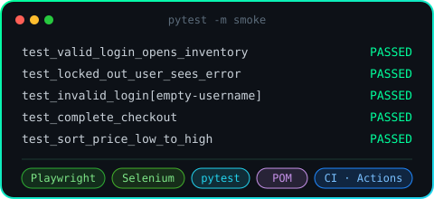
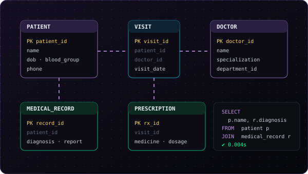
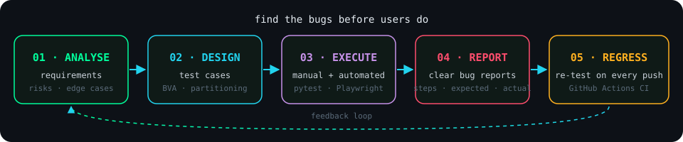

<!-- ═══════════════════════════  HEADER  ═══════════════════════════ -->

  

  
  
  
  

  

---

<!-- ═══════════════════════════  HERO  ═══════════════════════════ -->

  

## 🧠 About Me

- 🎓 **B.Sc. in Computer Science & Engineering** at **Port City International University**, CGPA **3.88**
- 🔍 Came to QA from development: building Django apps showed me how bugs get in, from unclear requirements to untested edge cases
- 🧪 **Manual testing:** test scenarios, test cases, execution and clear, reproducible bug reports
- 📐 **Test design:** boundary value analysis, equivalence partitioning, functional, regression, smoke and sanity testing
- 🤖 **Learning automation:** Python, pytest, Selenium, Playwright and CI with GitHub Actions
- 🏫 Volunteer with the **PCIU Computer Club**, helping peers learn programming and running workshops
- 🎯 Looking for **SQA internships and junior QA roles**

---

<!-- ═══════════════════════════  PROJECTS  ═══════════════════════════ -->
## 🚀 Featured Projects

<table>
  <tr>
    <td width="50%" valign="top">
      
      <h3 align="center">🧪 SQA Automation Framework</h3>
      
UI test suite for a demo e-commerce site: login, cart, checkout and sorting, tested with both Playwright and Selenium using the Page Object Model, with CI on every push.

      
<code>Python</code> • <code>pytest</code> • <code>Playwright</code> • <code>Selenium</code> • <code>GitHub Actions</code>

      

    </td>
    <td width="50%" valign="top">
      
      <h3 align="center">🩺 DiagnoCare</h3>
      
Django diagnostic-test booking app I built, now my testing practice ground: test cases for the booking flow and role-based access, plus the bugs I find.

      
<code>Django</code> • <code>Python</code> • <code>MySQL</code> • <code>Test Cases</code>

      

    </td>
  </tr>
  <tr>
    <td width="50%" valign="top">
      
      <h3 align="center">📋 Patient Record Management System</h3>
      
Relational database design for patients, doctors, visits, prescriptions and medical records, the SQL I now use to verify backend data while testing.

      
<code>MySQL</code> • <code>SQL</code> • <code>ER Design</code>

      

    </td>
    <td width="50%" valign="top">
      
      <h3 align="center">🏠 Bangladesh House Price Predictor</h3>
      
Machine-learning model that estimates apartment prices in major Bangladeshi cities. <i>Code and data-pipeline tests coming soon.</i>

      
<code>Python</code> • <code>Pandas</code> • <code>scikit-learn</code>

      

    </td>
  </tr>
</table>

---

<!-- ═══════════════════════════  PIPELINE  ═══════════════════════════ -->
## 🧬 How I Test

  

---

<!-- ═══════════════════════════  TECH STACK  ═══════════════════════════ -->
## 🛠️ Tech Arsenal

  
  
  
  
  
  

  
    
  

---

<!-- ═══════════════════════════  STATS  ═══════════════════════════ -->
## 📊 GitHub Telemetry

  
  

  <picture>
    <source media="(prefers-color-scheme: dark)" srcset="https://raw.githubusercontent.com/shihab-hossain1/shihab-hossain1/output/github-snake-dark.svg"/>
    
  </picture>

---

<!-- ═══════════════════════════  ETHOS  ═══════════════════════════ -->
## ⚡ Testing Principles

> *"Quality isn't a phase at the end. It's how the whole thing gets built."*

<table>
  <tr>
    <td width="33%" valign="top">
      <h4>🎯 Think Like a User</h4>
      Test the paths real people take, then the ones nobody planned for.
    </td>
    <td width="33%" valign="top">
      <h4>🐞 Reproducible or It Didn't Happen</h4>
      Every bug report has clear steps, expected vs actual, and evidence.
    </td>
    <td width="33%" valign="top">
      <h4>🔁 Automate the Repeatable</h4>
      Regression checks belong in CI so people can focus on exploring.
    </td>
  </tr>
</table>

---

<!-- ═══════════════════════════  CONTACT  ═══════════════════════════ -->
## 📡 Contact Deck

  
  
  
  

<table align="center">
  <tr>
    <td align="center" width="200">
      <b>Scan to connect on LinkedIn</b>  
      
    </td>
    <td align="center" width="420">
      
    </td>
  </tr>
</table>

<!-- ═══════════════════════════  FOOTER  ═══════════════════════════ -->

  

