<!-- ═══════════════════════════  HEADER  ═══════════════════════════ -->

  

  
  
  
  

  

---

<!-- ═══════════════════════════  HERO  ═══════════════════════════ -->

  

## 🧠 About Me

- 🎓 Final-year **B.Sc. in Computer Science & Engineering** at **Port City International University** — CGPA **3.88**
- 🐍 **Python developer & competitive programmer** with strong fundamentals in C, C++ and Java
- 🤖 Focused on **Artificial Intelligence** — Machine Learning, NLP and Computer Vision
- 🔌 Builds hardware too: **Arduino & IoT** projects that connect code to the physical world
- 🏫 Active member of the **PCIU Computer Club** — teaching peers and helping run workshops
- 🎯 Goal: grow into an **AI Engineer** who ships impactful, real-world software

---

<!-- ═══════════════════════════  PROJECTS  ═══════════════════════════ -->
## 🚀 Featured Projects

<table>
  <tr>
    <td width="50%" valign="top">
      
      <h3 align="center">🏠 Bangladesh House Price Predictor</h3>
      
Machine-learning system that estimates apartment prices across major Bangladeshi cities from features like area, bedrooms and location.

      
<code>Python</code> • <code>Pandas</code> • <code>scikit-learn</code>

      

    </td>
    <td width="50%" valign="top">
      
      <h3 align="center">🩺 DiagnoCare</h3>
      
Django web app for booking diagnostic tests and managing patient reports — scheduling, report status and downloads in one place.

      
<code>Django</code> • <code>Python</code> • <code>MySQL</code> • <code>HTML/CSS</code>

      

    </td>
  </tr>
  <tr>
    <td width="50%" valign="top">
      
      <h3 align="center">📋 Patient Record Management System</h3>
      
Relational database design for storing and retrieving patients, doctors, visits, prescriptions and medical records.

      
<code>MySQL</code> • <code>SQL</code> • <code>ER Design</code>

      

    </td>
    <td width="50%" valign="top">
      
      <h3 align="center">☀️ Solar Tracking System</h3>
      
Arduino device that reads light sensors and turns a solar panel with a servo to follow the sun and maximise efficiency.

      
<code>Arduino</code> • <code>C++</code> • <code>LDR</code> • <code>Servo</code>

      

    </td>
  </tr>
</table>

---

<!-- ═══════════════════════════  PIPELINE  ═══════════════════════════ -->
## 🧬 How I Build

  

---

<!-- ═══════════════════════════  TECH STACK  ═══════════════════════════ -->
## 🛠️ Tech Arsenal

  
    
  

  
  
  
  
  

---

<!-- ═══════════════════════════  STATS  ═══════════════════════════ -->
## 📊 GitHub Telemetry

  
  

  

  

  <picture>
    <source media="(prefers-color-scheme: dark)" srcset="https://raw.githubusercontent.com/shihab-hossain1/shihab-hossain1/output/github-snake-dark.svg"/>
    
  </picture>

---

<!-- ═══════════════════════════  ETHOS  ═══════════════════════════ -->
## ⚡ Engineering Principles

> *"Good software solves a real problem, is easy to understand, and keeps working when the data gets messy."*

<table>
  <tr>
    <td width="33%" valign="top">
      <h4>🎯 Problem First</h4>
      Understand the problem and the data before choosing a model or a framework.
    </td>
    <td width="33%" valign="top">
      <h4>🧪 Measure Everything</h4>
      Validate models with proper metrics and test code before calling it done.
    </td>
    <td width="33%" valign="top">
      <h4>🧹 Clean & Readable</h4>
      Write code that teammates — and future me — can read, reuse and extend.
    </td>
  </tr>
</table>

---

<!-- ═══════════════════════════  TROPHIES  ═══════════════════════════ -->
## 🏆 Achievements

  

---

<!-- ═══════════════════════════  CONTACT  ═══════════════════════════ -->
## 📡 Contact Deck

  
  
  
  
  

<table align="center">
  <tr>
    <td align="center" width="200">
      <b>Scan to connect on LinkedIn</b>  
      
    </td>
    <td align="center" width="420">
      
    </td>
  </tr>
</table>

<!-- ═══════════════════════════  FOOTER  ═══════════════════════════ -->

  

